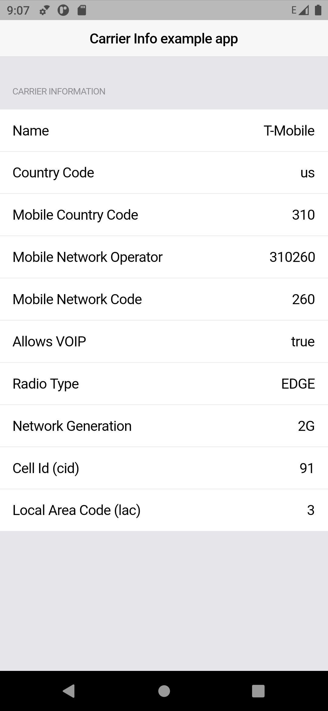
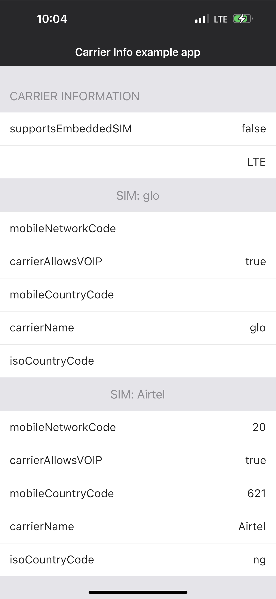

# 📱 Carrier Info

[](https://pub.dev/packages/carrier_info)

> **⚠️ IMPORTANT iOS 16.0+ NOTICE**: Apple has deprecated `CTCarrier` starting with iOS 16.0. This means that most carrier-specific information (carrier name, country codes, network codes, etc.) will return `nil` or generic values on iOS 16.0 and later versions. This is an Apple platform limitation, not a plugin issue. See the [iOS Limitations](#ios-limitations) section for more details.

Carrier Info gets networkType, networkGeneration, mobileCountryCode, mobileNetworkCode, and more from Android and iOS devices. It's a port from this [js project](https://github.com/react-native-webrtc/react-native-carrier-info) and an improvement on the existing [flt_telephony_info package](https://pub.dev/packages/flt_telephony_info).

## Requirements

- Flutter 3.44 or later, Dart 3.12 or later
- Android 7.0 (API 24) or later
- iOS 13 or later

## Quick start

`getSummary` returns the details both platforms report, so you do not need to branch on the platform:

```dart
final summary = await CarrierInfo.getSummary();

summary.isSimInserted;       // true
summary.networkGeneration;   // '5G'
summary.radioType;           // 'LTE' on 5G NSA, 'NR' on 5G SA
for (final sim in summary.sims) {
  print('${sim.carrierName} ${sim.mobileCountryCode}${sim.mobileNetworkCode} data: ${sim.isDataSim}');
}
```

Use `getAndroidInfo` and `getIosInfo` when you need everything a platform offers.

## New in 4.0

**Android**
- `networkGeneration` reports `5G` on 5G NSA networks, matching the status bar, instead of `4G`
- `displayNetworkType`: what the status bar shows, `NONE`, `LTE_CA`, `LTE_ADVANCED_PRO`, `NR_NSA` or `NR_ADVANCED` (Android 12+)
- `signalLevel` (0 to 4) and `signalDbm`
- `simCarrierId` and `simCarrierIdName` from Android's carrier database
- `networkOperator`: the MCC and MNC of the network you are on, which differs from the SIM when roaming
- `isNetworkRoaming`, `simSlotIndex`, `isUsingNonTerrestrialNetwork` (satellite, Android 15+)
- `activeDataSubscriptionId`: which SIM carries mobile data
- `isEsimEnabled` and `portIndex` for phones with several eSIM profiles
- Each SIM is now read on its own on dual-SIM phones

**iOS**
- `dataServiceIdentifier`: which SIM carries mobile data
- `cellularDataRestriction`: `restricted` when the user turned off mobile data for your app
- `networkStatus.isExpensive`, `isConstrained` (Low Data Mode) and `usesCellular`
- `supportsEmbeddedSIM` is filled at the top level too. Apple returns `false` to apps without the carrier entitlement, even on eSIM iPhones
- On iOS 16+, `getSummary` lists one SIM per subscriber with `isDataSim` set, since carrier names are no longer available

### Migrating from 3.x

Existing calls keep working with the same models and defaults. What changed:

- The minimum versions above went up.
- The plugin talks to the platform through [Pigeon](https://pub.dev/packages/pigeon). If your tests mocked the `plugins.chizi.tech/carrier_info` method channel, mock the Pigeon channels instead, or wrap `CarrierInfo` behind your own interface.
- A missing permission now empties only the fields that need it, instead of failing the whole call.
- Android: a device without telephony throws a `PlatformException` with the code `no_telephony`.

## 📸 Screen Shots

<p float="left">


</p>

### Fetching android carrier info

Docs: https://developer.android.com/reference/android/telephony/TelephonyManager#getNetworkCountryIso(), https://developer.android.com/reference/android/telephony/SubscriptionManager

```dart
 AndroidCarrierData? carrierInfo = await CarrierInfo.getAndroidInfo();
 returns  {
   "isVoiceCapable": true,
   "isDataEnabled": true,
   "subscriptionsInfo": [
     {
       "mobileCountryCode": "310",
       "isOpportunistic": false,
       "mobileNetworkCode": "260",
       "displayName": "T-Mobile",
       "isNetworkRoaming": false,
       "simSlotIndex": 0,
       "phoneNumber": "+15551234567",
       "countryIso": "us",
       "subscriptionType": 0,
       "cardId": 0,
       "isEmbedded": false,
       "carrierId": 1,
       "subscriptionId": 1,
       "simSerialNo": "",
       "dataRoaming": 0
     }
   ],
   "isDataCapable": true,
   "isMultiSimSupported": "MULTISIM_NOT_SUPPORTED_BY_HARDWARE",
   "isSmsCapable": true,
   "telephonyInfo": [
     {
       "networkCountryIso": "us",
       "mobileCountryCode": "310",
       "mobileNetworkCode": "260",
       "displayName": "T-Mobile",
       "simState": "SIM_STATE_READY",
       "isoCountryCode": "us",
       "cellId": {
         "cid": 47108,
         "lac": 8514
       },
       "phoneNumber": "+15551234567",
       "carrierName": "T-Mobile",
       "subscriptionId": 1,
       "networkGeneration": "4G",
       "radioType": "LTE",
       "networkOperatorName": "T-Mobile"
     }
   ]
 };
```

### Fetching iOS carrier info

```dart
 IosCarrierData iosInfo = await CarrierInfo.getIosInfo();

 // iOS 15.x and earlier: full carrier information. iosInfo.toMap() returns
 {
   "carrierData": [
     {
       "mobileNetworkCode": "20",
       "carrierAllowsVOIP": true,
       "mobileCountryCode": "621",
       "carrierName": "Airtel",
       "isoCountryCode": "ng"
     }
   ],
   "supportsEmbeddedSIM": true,
   "carrierRadioAccessTechnologyTypeList": ["LTE"],
   "isSIMInserted": true,
   "subscriberInfo": {
     "subscriberCount": 1,
     "subscriberIdentifiers": ["subscriber_id_here"],
     "carrierTokens": ["token_here"]
   },
   "cellularPlanInfo": {
     "supportsEmbeddedSIM": true
   },
   "networkStatus": {
     "hasCellularData": true,
     "activeServices": 1,
     "technologies": ["CTRadioAccessTechnologyLTE"],
     "isExpensive": true,
     "isConstrained": false,
     "usesCellular": true
   },
   "dataServiceIdentifier": "0000000100000001",
   "cellularDataRestriction": "notRestricted"
 }

 // iOS 16.0+: carrier fields are null, everything else is unchanged
 {
   "carrierData": [
     {
       "mobileNetworkCode": null,
       "carrierAllowsVOIP": null,
       "mobileCountryCode": null,
       "carrierName": null,
       "isoCountryCode": null
     }
   ],
   ...
 }
```

## iOS Features

### Available on All iOS Versions

#### SIM Detection
- **isSIMInserted**: Boolean indicating if a SIM card is inserted and active
- **networkStatus**: Real-time network connectivity information
- **carrierRadioAccessTechnologyTypeList**: Current radio technology (2G, 3G, 4G, 5G)

#### Network Status
```dart
"networkStatus": {
  "hasCellularData": true,        // Cellular data available
  "activeServices": 1,            // Number of active cellular services
  "technologies": ["LTE"]         // Current radio access technologies
}
```

#### Subscriber Information
```dart
"subscriberInfo": {
  "subscriberCount": 1,                           // Number of subscribers (dual SIM)
  "subscriberIdentifiers": ["subscriber_id"],     // Subscriber identifiers
  "carrierTokens": ["token"]                      // Carrier authentication tokens
}
```

#### Cellular Plan Information
```dart
"cellularPlanInfo": {
  "supportsEmbeddedSIM": true     // eSIM support detection
}
```

### iOS Version Detection

On iOS 16 and later the carrier name and codes come back as `null`. Check for that instead of the iOS version:

```dart
final iosInfo = await CarrierInfo.getIosInfo();
final carrier = iosInfo.carrierData.firstOrNull;

if (carrier?.carrierName == null) {
  print('SIM Inserted: ${iosInfo.isSIMInserted}');
  print('Radio Tech: ${iosInfo.carrierRadioAccessTechnologyTypeList}');
} else {
  print('Carrier: ${carrier!.carrierName}');
}
```

## iOS Limitations

### CTCarrier Deprecation (iOS 16.0+)

Starting with iOS 16.0, Apple has deprecated the `CTCarrier` class and related APIs for privacy and security reasons. This affects the following information:

**❌ No longer available on iOS 16.0+:**
- Carrier name (`carrierName`)
- Mobile country code (`mobileCountryCode`)
- Mobile network code (`mobileNetworkCode`)
- ISO country code (`isoCountryCode`)
- VOIP allowance (`carrierAllowsVOIP`)

**✅ Still available on iOS 16.0+:**
- SIM insertion detection (`isSIMInserted`)
- Radio access technology types (`carrierRadioAccessTechnologyTypeList`)
- Network status (`networkStatus`)
- Subscriber information (`subscriberInfo`)
- Cellular plan information (`cellularPlanInfo`)

### Recommendations

1. **Check for null**: Carrier fields are `null` on iOS 16.0+, so handle that instead of checking the version.

2. **Use available features**: Focus on features that work across all iOS versions:
   ```dart
   // These work on all iOS versions
   final simInserted = iosInfo?.isSIMInserted ?? false;
   final hasData = iosInfo?.networkStatus?.hasCellularData ?? false;
   final radioTech = iosInfo?.carrierRadioAccessTechnologyTypeList ?? [];
   ```

3. **Graceful degradation**: Design your app to work without carrier-specific information on newer iOS versions.

4. **Alternative approaches**: Consider using network-based detection or user input for carrier information when needed.

5. **Android alternative**: For apps that require detailed carrier information, consider using the Android implementation which still provides full functionality.

### New iOS Models

The plugin now includes enhanced models for iOS data:

- **IosCarrierData**: Main container with all carrier information
- **CarrierData**: Individual carrier information (nullable fields for iOS 16.0+)
- **SubscriberInfo**: Subscriber and carrier token information
- **CellularPlanInfo**: Cellular plan provisioning information
- **NetworkStatus**: Real-time network connectivity status

### Technical References

- [Apple Developer Documentation - CTCarrier](https://developer.apple.com/documentation/coretelephony/ctcarrier)
- [Apple Developer Documentation - CTSubscriber](https://developer.apple.com/documentation/coretelephony/ctsubscriber)
- [Apple Developer Documentation - CTCellularPlanProvisioning](https://developer.apple.com/documentation/coretelephony/ctcellularplanprovisioning/)
- [Stack Overflow Discussion](https://stackoverflow.com/questions/76919011/ctcarrier-deprecation-issue-ios-16)
- [iOS 16.0 Release Notes](https://developer.apple.com/documentation/ios-ipados-release-notes/ios-ipados-16-release-notes)

### Permissions
Add the permissions you need to your Android manifest, and request the runtime ones yourself, for example with [permission_handler](https://pub.dev/packages/permission_handler):

```xml
  <uses-permission android:name="android.permission.ACCESS_NETWORK_STATE" />
  <uses-permission android:name="android.permission.READ_PHONE_STATE" />
  <uses-permission android:name="android.permission.READ_PHONE_NUMBERS" />
  <uses-permission android:name="android.permission.ACCESS_FINE_LOCATION" />
```

- `READ_PHONE_STATE`: subscriptions, data network type, SIM state, signal strength
- `READ_PHONE_NUMBERS`: phone numbers
- `ACCESS_FINE_LOCATION`: `cellId`

Fields whose permission is missing come back empty. `simSerialNo` is always empty on Android 10 and later, because only system apps can read the SIM serial number.

## ✨ Contribution

Lots of PR's would be needed to make this plugin standard, as for iOS there's a permanent limitation for getting the exact data usage, there's only one way around it and it's super complex.
